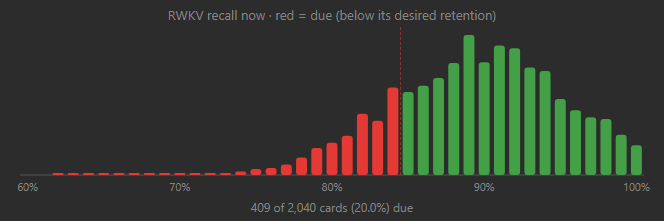
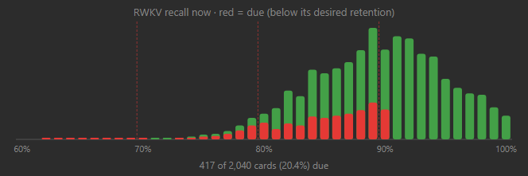
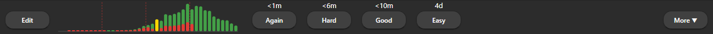

# RWKV Recall Histogram

An Anki desktop add-on that shows how your cards are spread across **RWKV
retrievability (R) right now**: one bar per percent of R. The red part of each
bar is the cards that are due, meaning at or below their own desired retention;
the rest of the bar is green.

Each card is judged against its own target, so per-card desired retention (for
example from the Dynamic Desired Retention add-on) is shown correctly: a card
at 80% with an 85% target is red, a card at 65% with a 60% target is green.
Dashed lines mark the desired retentions in use.

**[Download RWKV-Recall-Histogram.ankiaddon](https://github.com/sommepo/rwkv-recall-histogram/releases/latest/download/RWKV-Recall-Histogram.ankiaddon)**

The chart sits under the deck list, and without any text in the review screen's
bottom bar, beside "Edit". Once a card's answer is showing, the bar for that
card's RWKV R turns yellow.

### Without per-card desired retention

Every card uses its preset's target, here 85%, so each bar left of the line is
red.




### With Dynamic Desired Retention

Cards have their own targets, here 70%, 80% and 90%, so a bar can be part due.





The screenshots use sample data, with the current card at 82% in the reviewer.

**Requires the RWKV Instant Anki fork.** Tested on Windows with the
`26.9b3+fsrs7` build of [JSchoreels/anki](https://github.com/JSchoreels/anki).
Standard Anki, AnkiMobile, and AnkiDroid are not supported. This add-on uses
internal fork APIs, so compatibility with other builds is not guaranteed.

## Install

1. Download `RWKV-Recall-Histogram.ankiaddon` from the link above, or from the
   [latest release](https://github.com/sommepo/rwkv-recall-histogram/releases/latest).
2. In Anki, open **Tools → Add-ons → Install from file** and select the download.
3. Restart Anki.

## How it works

The RWKV scheduler owns the prediction. The add-on asks the fork for the same
per-percent retrievability series the Stats screen uses and only draws it; it
does not change scheduling, card data, or deck options.

- "Due" is the fork's own `is:rwkv:due` search: review cards in RWKV-Instant
  decks whose R is at or below their desired retention and that pass the
  same-day and repeat-spacing rules. Daily review limits and the minimum
  reviews per day setting are not applied.
- It works the same with or without a per-card desired-retention add-on, and
  needs no setting. Without one, every card's target is its preset's desired
  retention, so there is one dashed line per preset and the bars left of it
  are red.
- With such an add-on, the dashed lines are the desired retentions the fork
  last resolved for a review queue. They appear once a deck's queue has been
  scored, and are left out when a rule gives nearly every card its own target.
- On a fork build without the due search, the chart falls back to one red line
  at `desired_retention`: cards below it are red, cards just above it orange.
- The deck list chart is recounted in the background and reused for
  `refresh_seconds`, so the deck list never waits for the scheduler.
- The review screen chart is recounted in the background on every card. It
  hides itself when the window is too narrow to fit it between "Edit" and the
  answer buttons.
- The yellow bar is the fork's own RWKV R for the current card, rounded the
  same way as the fork rounds it for display. It appears with the answer and
  works the same with or without per-card desired retention. A card with no
  RWKV prediction shows no yellow bar.
- While RWKV is still warming up the chart shows "Loading…" and fills in once
  the scores are ready.

## Settings

**Tools → Add-ons → RWKV Recall Histogram → Config**

- `desired_retention`: fallback only. Where the red line sits when the fork cannot report due cards. `0.80` or `80`.
- `search`: which cards are counted (any Anki search). The default leaves out suspended cards.
- `min_percent`: lowest left edge of the chart. Cards below it are piled onto the first bar; the chart starts further right when there are no cards that low.
- `near_target_points`: fallback only. Cards this many points above the line are orange, the rest green.
- `refresh_seconds`: how long a count is reused before the deck list asks RWKV again.
- `show_in_reviewer`: also show the small text-free chart in the review screen's bottom bar.

## Development

```sh
python scripts/build.py
```

writes `dist/RWKV-Recall-Histogram.ankiaddon`.

## License

GNU Affero General Public License, version 3 or later. See [LICENSE](LICENSE).
This is an independent add-on and is not an official Anki release.
