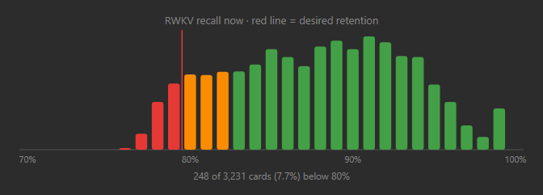
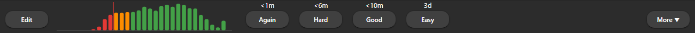

# RWKV Recall Histogram

An Anki desktop add-on that shows how your cards are spread across **RWKV
retrievability (R) right now**: one bar per percent of R, with a red line at
your desired retention. Cards below the line are red, cards just above it are
orange, the rest are green.

**[Download RWKV-Recall-Histogram.ankiaddon](https://github.com/sommepo/rwkv-recall-histogram/releases/latest/download/RWKV-Recall-Histogram.ankiaddon)**

Under the deck list:



In the review screen's bottom bar, beside "Edit", without any text:



The screenshots use sample data.

**Requires the RWKV Instant Anki fork.** Tested on Windows with the
`26.9b3+fsrs7` build of [JSchoreels/anki](https://github.com/JSchoreels/anki).
Standard Anki, AnkiMobile, and AnkiDroid are not supported. This add-on uses
internal fork APIs, so compatibility with other builds is not guaranteed.

## Install

1. Download `RWKV-Recall-Histogram.ankiaddon` from the link above, or from the
   [latest release](https://github.com/sommepo/rwkv-recall-histogram/releases/latest).
2. In Anki, open **Tools → Add-ons → Install from file** and select the download.
3. Restart Anki.

## How it works

The RWKV scheduler owns the prediction. The add-on asks the fork for the same
per-percent retrievability series the Stats screen uses and only draws it; it
does not change scheduling, card data, or deck options.

- The deck list chart is recounted in the background and reused for
  `refresh_seconds`, so the deck list never waits for the scheduler.
- The review screen chart is recounted in the background on every card. It
  hides itself when the window is too narrow to fit it between "Edit" and the
  answer buttons.
- While RWKV is still warming up the chart shows "Loading…" and fills in once
  the scores are ready.

## Settings

**Tools → Add-ons → RWKV Recall Histogram → Config**

- `desired_retention`: where the red line sits; cards below it are red. `0.80` or `80`.
- `search`: which cards are counted (any Anki search). The default leaves out suspended cards.
- `min_percent`: lowest left edge of the chart. Cards below it are piled onto the first bar; the chart starts further right when there are no cards that low.
- `near_target_points`: cards this many points above the line are orange, the rest green.
- `refresh_seconds`: how long a count is reused before the deck list asks RWKV again.
- `show_in_reviewer`: also show the small text-free chart in the review screen's bottom bar.

## Development

```sh
python scripts/build.py
```

writes `dist/RWKV-Recall-Histogram.ankiaddon`.

## License

GNU Affero General Public License, version 3 or later. See [LICENSE](LICENSE).
This is an independent add-on and is not an official Anki release.
